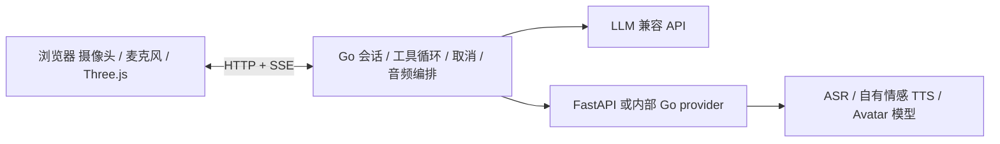

# Avatar Harness · Go

以数字人画面为主体的桌面 Harness：终端配置 provider，Go 负责会话、工具循环、流式转发、取消和音频编排，浏览器负责摄像头、麦克风与形象显示。右侧文字是事件日志，输入框用于补充文字或执行命令。

**运行核心使用 Go。** 正常启动不需要 Python、Node.js、CUDA 或另行下载模型权重。前端已打包进可执行文件；Python 模型作为独立服务接入。配置、密钥、会话与原 SQLite 文件保存在 `.avatar-harness/`，参考来源与许可见 `sources.lock.json` 和 `integrations/licenses/`。

Windows 电脑连接现有 data2 GPU 服务，请直接使用 [Windows Agent 部署指南](docs/windows-lan-agent.md)：优先在已有 WSL2 中运行 Go 与 SSH 隧道，Windows 浏览器负责渲染和麦克风；另有原生 PowerShell 备选方案。无需在客户端安装 Python / CUDA。

## 当前 Mac 启动

```bash
cd '/Users/huangmingru/Library/CloudStorage/OneDrive-个人/Notes/DigitalPerson/avatar-harness'
./start
```

首次启动进入配置向导；已有配置时，终端提供“启动 Web / 配置 provider / 配置形象 / 退出”。选择启动后打开 `http://127.0.0.1:8765`。本工作区已配置百炼语音服务与本地 LAM 角色；通用初始配置仍允许将模型模块留待接入。

```bash
./start configure all
./start configure llm
./start configure-avatar
./start add-character
./start add-tool
./start providers
./start doctor --probe
./start serve --no-open
./start stop
```

同一配置重复启动会复用已运行服务；配置或密钥更新后再次启动，会自动重启加载。密钥从环境变量或配置目录中的 `secrets.env` 读取，终端输入隐藏，文件权限 0600，不返回给浏览器。

## 先使用阿里云百炼

```bash
./start configure bailian
./start stop
./start
```

一次配置北京地域的三个服务，共用 `DASHSCOPE_API_KEY`。可填写业务空间 ID 使用专属域名；留空使用仍受支持的公共域名。已有环境变量或 `secrets.env` 密钥会自动复用。

| 模块 | 默认模型 | 协议 |
|---|---|---|
| 对话与工具调用 | `deepseek-v4.1-flash-1017`，关闭思考模式 | OpenAI 兼容 SSE |
| 语音识别 | `qwen3-asr-flash-realtime` | 原生 WebSocket，Manual 提交 |
| 语音合成 | `qwen-audio-3.1-tts-flash`，默认 `longanhuan_v3.1` | 原生 WebSocket，PCM 分片与情感指令 |

模型 ID 和音色可在向导中调整。暂时不填密钥可运行 `./start configure bailian --defaults` 保存预设，页面显示“缺少密钥”。本工作区已经配置并验证真实百炼调用。密钥必须属于北京地域并有对应模型权限；未取得密钥时不发起云端推理。

LLM 在同一条结构化回复里给出七类情感（中性、快乐、悲伤、愤怒、恐惧、惊讶、厌恶）与强度，本地同时驱动脸部参数和 TTS 的自然语言语气指令，不增加额外模型调用。开发模式可手动预览七类表情，原有认真、关切另列为交流风格。

百炼语音适配器直接编译在 Go 中，无需另起 Python/FastAPI。0.3 版使用持续 WebSocket：浏览器以约 32ms 帧发送 16 kHz PCM，Go 同时上行音频、下行临时转录。默认 80ms 持续有声触发插话，400ms 静音后提交；无需第二次服务端静音等待。TTS 增量音频按序进入播放队列。详细接入和验证边界见 [百炼接入说明](docs/bailian.md)。

数字人使用浏览器 LAM 高斯渲染，当前启动示例通过 data2 官方 LAM-A2E 服务推理语音动作；也支持 Three.js/VRM 或外部渲染服务。百炼 `wan2.2-s2v` 是图片和音频驱动的异步视频生成任务，当前未放进实时回应链路，也没有将它宣称为实时表情驱动。

## Provider 接入

| 形式 | 用途 |
|---|---|
| 原生 OpenAI 兼容接口 | 千问、百炼、vLLM 等 LLM 服务，填写基础 URL、模型 ID 和密钥环境变量 |
| 百炼原生 WebSocket | Qwen-ASR / Qwen-TTS 实时语音，在 Go 内直接转换为 Harness 音频协议 |
| FastAPI / 自有 HTTP 服务 | LLM、ASR、TTS、Avatar 和工具，使用本文的 `/invoke`、可选 `/stream` 协议 |
| 内部 Go 函数 | 编译进 Harness，通过 `provider.Bus.Register` 注册；适合轻量工具或 Go 原生适配器 |

**FastAPI 指外部 provider 的服务接入形式。Harness 本身使用 Go HTTP 服务。** 实现相同协议的其他语言服务也可以接入。百炼实时语音已有内置适配器；其他原厂 ASR/TTS 的 WebSocket、SDK 等协议仍需转换，不能直接把任意厂商 URL 当成 `/invoke`。

Python 模型无需改写成 Go。将常驻推理封装为 FastAPI，再通过终端选择该 provider。GPU 权重应由外部服务启动时加载，不能每次调用重新加载。内部 Go 函数名需要在编译时注册，旧 `module:function` 不再在主进程内执行。

完整请求、流事件与数字人驱动协议见 [provider-contract.md](docs/provider-contract.md)。

外部服务的 CPU 示例在 `examples/fastapi_provider.py`，需要独立 Python 环境中的 FastAPI 与 uvicorn。它实际统计文字，也可按 `AVATAR_ASSET_URL` / `AVATAR_RENDER_URL` 返回已有形象描述；没有假 ASR/TTS/表情结果。启动示例后可验证：

```bash
./start --config configs/fastapi-tool.example.json tool text_stats --args '{"text":"你好，数字人Harness"}'
./start --config configs/fastapi-avatar.example.json tool avatar --args '{"operation":"describe"}'
```

## 数字人 API 与画面

形象的显示方式与驱动模型分开配置。

| 方式 | API / 资产 | 浏览器如何显示 |
|---|---|---|
| GLB / VRM | 本地文件或资产 URL；驱动 API 返回带时间戳的表情、口型和头部参数 | Three.js + three-vrm 本地 WebGL 渲染 |
| LAM ZIP | 本地文件或 ZIP URL；GPU API 或浏览器 Worker 从真实 TTS 音频生成动作 | 浏览器专用高斯渲染器；驱动可远程部署 |
| 专用渲染服务 | provider 返回渲染页面 URL | 嵌入页面，使用服务自己的 SDK |
| 服务端视频 | provider 返回浏览器可播放的视频 URL | 原生 video；WebRTC 可由专用渲染页面处理 |

开发模式的“导入形象”可以导入本地 GLB/VRM，填写资产 URL、渲染页面 URL 或视频 URL。也可加载已打包的 pixiv VRM 开源示例，验证真实 3D 加载、上半身视角和重置。示例版权与许可保存在 [NOTICE](web/public/models/NOTICE.md)，它不代表已经运行语音或表情推理。

任意真实或卡通 GLB/VRM 都可以显示；要接受口型与表情驱动，资产必须有对应 morph targets / VRM expressions。当前接收 ARKit 命名的 morph targets、VRM 表情和头部四元数。静态网格不会自动获得面部控制能力。

当前默认角色为 LAM 高斯数字人，已接入真实音频神经口型、待机／说话动画、眨眼，以及 LLM 自动选择的中性／快乐／悲伤／愤怒／恐惧／惊讶／厌恶七类表情。当前男性 LAM 角色单独绑定龙天男声；认真、关切保留为兼容交流风格。单次 LLM 流中的情绪参数和正文分别解析，TTS 不等待完整 JSON；开发模式支持手动脸部覆盖。使用、模型来源、限制和同步说明见 [LAM 渲染与驱动](docs/lam-local.md)。原始资产与生成方法见 [LAM 角色说明](../assets/characters/lam/README.md)。

当前机器配置已改为 data2 官方 LAM-A2E CUDA 驱动，Mac 不加载本地口型模型；LAM/LHM++ 离线形象制作也部署在 data2。连接方式和实测记录见 [data2 模型服务](docs/data2-models.md)。浏览器高斯渲染仍在 Mac，主服务按需手动启动。

LAM ZIP 使用专用高斯渲染器，GLB/VRM 继续使用 GLTFLoader。现有 OpenAvatarChat 可以通过 `/oac/v1/chat/completions` 使用 Go 的 LLM 与工具循环：

```bash
./start export-oac --asset /实际路径/预生成角色.zip --harness-url http://控制端地址:8765
```

本地 LAM 路径无需启动 OpenAvatarChat 或 GPU 服务；上述桥接用于另接外部 OpenAvatarChat 客户端。

## 摄像头与语音输入

默认 Go 启动的页面为用户界面：保留人物选择、摄像头、语音控制、简要运行状态及整体响应时间。部位滑杆、手动情绪、模型/接口配置、工具参数与分项性能数据只在 Vite 开发模式显示；生产页面没有开启这些功能的开关。

七类情绪对照使用独立页面 `http://127.0.0.1:8765/demo/emotions`，不在主界面放置测试入口。点击“七情绪演示”后按中性、快乐、悲伤、愤怒、恐惧、惊讶、厌恶顺序播放同一句话，非中性表达强度为 1，中性作为基线。每句实际播完后停留 1.1 秒，再进入下一类；可以随时停止。使用当前角色音色与原 TTS/GPU 口型链路，不调用 LLM，不写入模型对话历史。

演示开始时停止麦克风采集并释放手动覆盖；结束或取消后恢复原表情模式，麦克风由用户重新开启。展示页只呈现情绪、台词和进度，不显示驱动系数。当前采用夸张表达：眉部、面颊、鼻翼与嘴角允许超过普通形变范围，眼睑增幅单独限制，TTS 使用戏剧化演绎指令；日常对话不使用这一层额外增强。固定姿态对照暂停音频对上半脸的额外预测和能量重音，保留真实发音、眨眼和额头随眉联动；资产没有独立动态皱纹。

- 摄像头只有点击“开启摄像头”才请求权限，显示实时本地预览。默认没有画面上传或情感推理。
- “开始说话”连接实时识别并请求麦克风权限。AudioWorklet 连续发送 PCM，临时转录显示在画面下沿；说话期间已经开始识别。非实时 ASR provider 继续使用 WAV 整句入口。
- `limits.voice_silence_ms` 和 `voice_onset_ms` 可调整停顿与插话检测时间，默认分别为 400ms 与 80ms。
- 未配置 ASR 时，麦克风只做本地检测，音频不上传。该 VAD 是轻量能量门限，不是神经语音检测模型。
- 再次开口时立即停止本地音频，再取消旧 ASR/LLM/工具/TTS；停止按钮等待后台确认。独立输入 ID 隔离迟到转录和旧轮次音频。结束聆听也会关闭实时识别连接。
- 浏览器首次使用需要用户允许相应设备。物理设备采集尚未代用户授权验证；拒绝权限和数据编码路径有自动检查。

## 流水线与性能边界



每轮有独立取消上下文。工具参数拼完整并通过 JSON Schema 后才执行；工具批次共用预算。工具决策文字不进入 TTS；模型提交可播报正文后，边生成边分段合成、有界预取并按样本顺序发出。百炼 TTS 的每条工作通道在 LLM 生成期间提前建连，本轮多段复用同一 commit 会话；首段采用较短长度目标和默认 180ms 软等待预算，不必一直等到句号。后续段使用默认 400ms 预算，在安全切分边界继续流水处理。

前端拒绝旧轮次音频；三秒语音指标在 AudioContext 起播后报告，音画同步另外核验。分段参数、连接计时和本地／真实云端验证见 [分段流水线优化记录](docs/realtime-pipeline-optimization.md)。

3D 动作使用最终音频的同一 PTS，跟随浏览器 AudioContext 的实际排程时间。没有匹配驱动参数或实际渲染记录时，不报告音画达标。云端响应、ASR、TTS、Avatar 推理与网络仍是独立延迟来源。

Go 控制面有独立的基准程序：使用明确的本地脚本化 HTTP 模型协议，执行两次 HTTP 模型请求、真实时钟工具、SSE 与日志。实测结果见 [单路](docs/performance-go-1.json)、[8 路并发](docs/performance-go-8.json)。这是控制面开销检查，**不是模型性能或三秒语音反馈结果**。

会话改为 Go 追加日志存储，250ms 刷新缓冲，正常退出同步；异常断电可能丢失未刷新的尾部。音频与逐帧参数不写入历史。旧 SQLite 在旧服务停止且没有未 checkpoint 的 WAL 时，只读导入一次，保留原文件；导入依赖可选 `sqlite3`，不属于正常运行依赖。

## 构建与检查

源代码构建需要 Go 1.24+ 和 Node.js 22+。当前工作区已在项目缓存准备 Go 编译器，不修改系统安装。

```bash
cd web
npm ci
npm test
npm run build
cd ..
./scripts/go test -race ./...
./scripts/build
./bin/avatar-harness serve --no-open
```

重新测量控制面：

```bash
./scripts/go run ./cmd/harness-bench --requests 1000 --concurrency 8 --output docs/performance-go-8.json
```

可执行文件内嵌 UI、工作线程脚本和示例资产，部署时不需要 Node。修改前端源码后先重新 `npm run build`，再编译 Go。

## 当前完成范围

Go 主进程、provider 协议、工具循环、连续识别、流式合成、逐轮取消和桌面工作台已实现。当前使用百炼 DeepSeek Flash + Qwen-ASR/TTS，完成真实云端与浏览器合成录音检查；本地 LAM 渲染、语音驱动与表情已接入；物理麦克风与长会话时延需继续实测。情感语音质量、PAD 动态融合与 RAG 尚待接入。通用 `init --defaults` 保持无服务配置。运行与延迟检查见 [实时语音验证](docs/realtime-voice-validation.md)，最新布局见 [截图](docs/design-v3/render-1600.jpg)。
