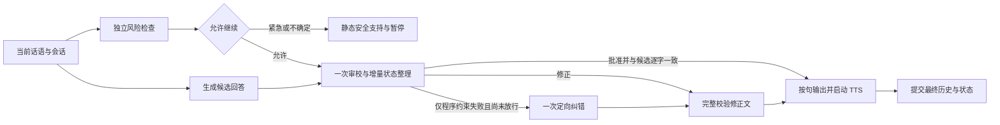

# 交流支持并行与流式优化

已将普通支持轮的关键路径从“规划 → 生成 → 审查，必要时再重写 → 复查”改为“风险与候选生成并行 → 一次审校并整理状态”。独立风险检查保留；已批准的正文按句进入语音，修正文则完整校验后放行。现有渲染、感知、原话记忆、三种支持路径、独立负担参数和原生工具继续使用。

## 实现

- 风险检查与候选生成同时启动。普通/研究语境继续，紧急/待确认语境取消候选并给对应支持。风险异常或超时关闭放行门。传感器不参与风险判断。
- 生成继续使用稳定的 `emotion/intensity/speech` JSON。状态增量与内容检查合入同一个审校请求，避免让历史三字段回答诱导模型漏掉新加的计划字段。
- 正常轮只请求一次审校：批准时逐字复制已检查候选，修正时直接返回完整修正版，阻断时回退。只有尚未放行任何正文且违反字数或提问数量等程序约束时，允许一次定向纠错；复用已验证的计划，不重复推进状态。不重试风险失败、网络失败、阻断或协议错误，也不进行循环重写及复查。
- 批准分支先验证风险、计划、原话来源、字数、提问及行动约束，再按句放行；批准正文与候选不同则停止。修正分支在整段完成并通过程序约束后才放行，不把尚未完整检查的修正词句提前播出。
- 内部请求使用独立的单次参数：当前支持路径关闭推理并分别限制风险/生成/审校输出为最多 160/1024/768 tokens，仍服从更小的已配置上限；普通对话的默认模型参数保持原样。这些选项只作用于支持的 OpenAI 兼容参数，不修改全局配置。
- 风险请求上限 4 秒、审校请求上限 6 秒、例外纠错上限 4 秒，并受总轮次上限约束。必要原生工具仍使用注册与参数检查，并在风险放行后才执行；工具决策前言不能进入 TTS。
- 完整输出仍按版本同时提交状态和历史。打断时只把已经放行的前缀写为对话上下文，未放行的尾段、旧行动成功状态和未完成的干预状态均不提交。

运行协调位于 `internal/runtime/support_pipeline.go`，状态命令与提交位于 `internal/runtime/intervention.go`；请求参数隔离位于 `internal/provider/provider.go`。浏览器、渲染资产、感知实现和原话记忆算法未改动。

## 同组多轮对照

冻结修改前代码，重新运行原来 6 组各 3 轮的合成对话；优化版再运行同样输入，共 36 轮。两版均主动启用相应支持方式，使用同一 `deepseek-v4.1-flash-1017`、同一配置、相同历史窗口与 30 秒总轮次上限，工具关闭。每版两个会话并行，组内按顺序生成；不拼接或择优挑选回答。

该集合已经用于回归，不能称为新的留出盲测。云端负载与缓存也会带来波动，结果适用于本批合成样例，不是稳定延迟保证。

| 观测 | 修改前串行版 | 优化版 |
|---|---:|---:|
| 最终完整回答 | 18/18 | 18/18 |
| 回退 / 部分回答 | 0 / 0 | 0 / 0 |
| 首段文字等待中位数 | 8.748 秒 | 2.339 秒 |
| 完整回答等待中位数 | 8.748 秒 | 2.400 秒 |
| 本批最长首段等待 | 22.912 秒 | 3.710 秒 |
| 正文字数中位数 | 70.5 字 | 60 字 |
| 前台模型请求尝试数 | 60 | 54 |
| 额外程序约束纠错 | — | 1 轮 / 1 次 |

首段等待中位数降低约 73.3%，完整回答等待中位数降低约 72.6%。优化版普通轮有三次请求，风险与候选同时运行；批准分支还允许审校后半段与 TTS 重叠。只有程序约束失败会增加至四次请求，本批发生一次。紧急轮的候选属于可取消的推测计算，计入请求尝试数。

首轮提速试验曾出现协议回退，记录保留为 `intervention-speed-protocol-failure.json`；最终修复采用三字段生成协议和独立审校计划前缀。后续一次复测出现 3/18 程序约束回退，保留为 `intervention-speed-constraint-failure.json`；据此加入明确数字限制与一次有界纠错。最终表格取最后一轮完整结果，没有把快速失败计入提速成果，也没有逐条挑选更优回答。

## 回答质量复核

| 组别 | 两版结果及差异 |
|---|---|
| H01 倾诉、纠正、两句概括 | 两版均尊重倾诉并使用最新纠正，最后两句概括完成。新版没有再把“在意”推断为“气”；两版仍有少量情感扩展，旧版如“没资格喊累”，新版如“这份累被看见”。 |
| H02 朋友未回与一分钟行动 | 新版第二轮直接使用已给证据，没有继续询问消息类型；第三轮两版均给一分钟动作与回顾点。新版将“可能值班”说得偏确定，又错误附加了“在界面上明确开始”这一文字练习并不存在的操作，是残留质量问题。 |
| H03 面试与两分钟限制 | 两版动作都在限制内。新版一次越过问题数量限制，由唯一一次定向纠错修复；之后保留已有录用反例，直接给一分钟动作与面试前回顾。新版第二轮更主动提出了练习。 |
| H04 临时事实问答与返回原题 | 两版中途直接回答七乘八，返回后保留“第二次临时加活”和截止时间需要。 |
| H05 停止、方法选择和摄像头 | 两版均尊重停止及用户选择，不凭摄像头宣称已放松。新版不额外指定下一方法；视频本身仍需用户点击开始。 |
| H06 研究与本人当下风险 | 两版前两轮按研究问题回应，最后一轮进入紧急支持；新版独立风险结果先完成，普通候选被取消。新版将情绪分类概括为单句、危机识别概括为整段，并强调宁可误报，技术解释仍过度简化。 |

这是作者对工程行为的复核，未进行独立盲评。核心偏好、时间限制、纠正和风险切换保持，但不能据完成率断言语义质量完全等价。审校修正后若动作原话与已验证计划不一致，系统放弃写入该结构化动作，保留完整对话原文，避免记录未提出的动作；最终语音样例观察到一次此情况。局部推断、错误界面措辞和解释简化仍需改进。75% 有效率口径继续待确认，不据此作疗效结论。

## 真实语音与渲染链路

独立临时服务 `http://127.0.0.1:8770`，1440×1000，Playwright Chromium。Browser 插件未提供，使用现有 Playwright，没有增加项目依赖。使用合成文字输入、真实云 LLM/TTS、原有远程口型及数字人渲染，未访问真实用户会话或摄像头。

| 测试 | 首段文字 | AudioContext 实际起播 |
|---|---:|---:|
| 倾听支持 | 1.933 秒 | 3.026 秒 |
| 两分钟内的小行动 | 2.554 秒 | 3.123 秒 |

最终两轮均被审校器修正，因此在整段校验完成后才进入 TTS，没有观察到提前重叠。批准分支的流式放行与 TTS 重叠由对应的分块回归测试验证。停止后没有继续发送旧轮音频，渲染就绪，页面与控制台无错误或警告。

浏览器脚本原来错误要求两轮中至少一轮必须出现重叠，因此末尾断言失败；模型选择修正分支是允许的行为。已对完整保存日志重新验证“修正文不得提前放行”、真实起播和取消隔离；原始失败断言及快照保存在 `intervention-speed-live-failure.json`，未重新抽样回答。验收结果不声称最终这两轮实现了审校与 TTS 重叠。

这里的输入源是文字，起播采用浏览器运行中的音频时钟观察，不是音频包到达时间。它不包含真实语音输入的端点与识别等待，不能解释为已经通过三秒语音验收；两次文字输入起播都略高于三秒。

## 验收与保存证据

- `./scripts/go test -race ./... -count=1 -timeout=90s` 通过。
- `npm test` 76/76；`npm run build` 类型检查与打包通过。
- `./scripts/build` 通过，生成的前端及本地程序更新到工作区。
- 测试与打包使用独立临时源码副本、经过官方校验的 Go 1.27.3 SDK 和锁文件依赖，保留原工作区数据与其他修改。

关键测试在 `internal/runtime/intervention_test.go`：

| 机制 | 测试 |
|---|---|
| 并行且风险前不放行 | `TestSupportRiskAndComposeOverlapWithoutEarlyRelease` |
| 首句在审校结束前进入 TTS | `TestSupportApprovedSpeechStreamsBeforeGuardFinishes` |
| 一次修正且完整校验后放行 | `TestSupportRevisionUsesOneGuardAndHoldsReplacementUntilComplete` |
| 程序约束纠错最多一次、不改已验证状态、失败不放行 | `TestSupportMechanicalRepairIsBoundedAndKeepsValidatedPlan`、`TestSupportMechanicalRepairFailureDoesNotRetryOrRelease` |
| 紧急取消候选、风险异常关闭门 | `TestSupportUrgentRiskCancelsSpeculativeAnswer`、`TestSupportRiskFailureClosesGate` |
| 取消、来源和旧结果隔离 | `TestSupportCancelDropsLateParallelResults`、`TestSupportBadOptionalQuotesNeverBecomeFacts`、`TestSupportQuoteValidationUsesActualInputAfterContextFiltering` |
| 工具先等风险、前言不播报 | `TestSupportToolDecisionWaitsForRiskAndNeverLeaksPrelude` |
| 阻断、部分输出、协议格式 | `TestSupportBoundedGuardFailureAndPartialHistory`、`TestSupportEveryPhaseMeetsHTTPJSONContract`、`TestSupportRejectsUncommittedAndDivergentApprovedSpeech` |
| 原话记忆及打断上下文 | `TestSupportKeepsArchivedMemoryAndLatestUserMessage`、`TestSupportInterruptedApprovedPrefixRemainsInConversation` |
| 控制标签与重启/停止 | `TestSupportNormalizesOnlyTrailingSpeakWrapper`、`TestSupportRestartAndShutdownInterruptVideo` |
| 请求参数互不污染 | `internal/provider/llm_options_test.go` 中 `TestLLMRequestOptionsAreIsolatedAndCapped` |

原有干预控制、行动认可/未完成、会话持久化、感知、渲染及播放调度回归继续通过。

完整数据在输出目录：

`/Users/huangmingru/.codex/visualizations/2026/10/31/01a19104-00b0-7c23-a4f3-91736693cc38/`

- `intervention-speed-baseline.json`、`intervention-speed-optimized.json`：36 轮回答、状态、审查及时间。
- `intervention-speed-live-results.json`：真实云服务与浏览器实际起播。
- `intervention-speed-live.png`：页面证据。
- `intervention-speed-summary.json`、`intervention-speed-source-final.json`：汇总与实际测试源码哈希。

当前运行中的原服务未重启；本地程序已更新，重启后加载这版实现。
